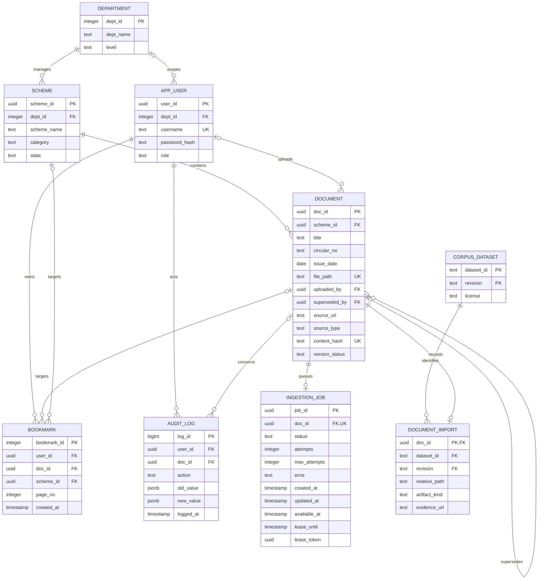

# Sprint 2 E3 PostgreSQL schema

### Normalization and constraints

- Each department stores its name and level once. Scheme identity is unique
  by department, name, and jurisdiction. Documents reference the scheme
  instead of repeating its department, category, or state. E2 resolves those
  fields through E3's parameterized joins.
- A bookmark belongs to one account and targets exactly one document or
  scheme. Page numbers apply only to document bookmarks. The partial B-tree
  indexes distinguish a document-level bookmark from a page bookmark and
  treat repeated null pages as duplicates. Scheme bookmarks are unique per
  account and scheme.
- Job status belongs to the job. Document version status defaults to
  `UNKNOWN` and changes independently of job execution. The migration
  preserves legacy status data. The single-table `index_job` view lets the
  existing E1 prepared statements update the same `ingestion_job` rows.
- Dataset license depends on dataset and revision, so document-level
  provenance references a release. SHA-256 identifies the original
  bytes and deduplicates them across imports. Older PDFs without hashes
  are preserved. New or updated PDF rows require both the hash and relative file path.
- Foreign keys restrict deletion where official or historical records are
  referenced. Named B-tree indexes cover state/category/department filters,
  reverse FK lookups, available jobs, and active leases. The existing
  operational log is retained. The new audit table reserves storage for
  Sprint 3 auditing and supersession.

Apply [migration 003](../db/migrations/003_e3_metadata.sql) after the two
foundation migrations. An existing database with conflicting rows must be
reviewed before applying new unique constraints. The migration is
transactional and contains no destructive data reset.
